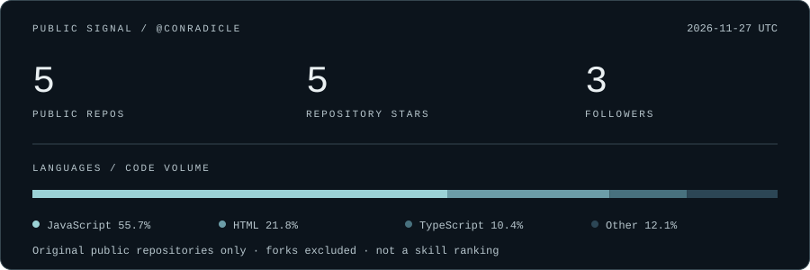

  <a href="https://conradgelber.com/">Website</a> &nbsp; / &nbsp;
  <a href="https://archimedeslab.dev/">Archimedes</a> &nbsp; / &nbsp;
  <a href="https://miamidadecommissionwatch.com/">Commission Watch</a> &nbsp; / &nbsp;
  <a href="https://www.linkedin.com/in/conradgelber">LinkedIn</a>

<picture>
  <source media="(max-width: 600px)" srcset="assets/terminal-mobile.svg" />
  
</picture>

I build things that make government easier to understand, and I’m interested in how technology and security shape the world.

### 01 / Selected work

Studying how public evidence can improve AI assessments of disclosed software vulnerabilities. The prospective study has not begun; no validated research findings are available.

[Explore the research ↗](https://archimedeslab.dev/)

I co-founded Miami-Dade Commission Watch and build the software behind it: meeting coverage in English, Spanish, and Haitian Creole, commissioner information, and a district lookup tool.

[Visit Commission Watch ↗](https://miamidadecommissionwatch.com/) · [Source](https://github.com/conradicle/miamidadecommissionwatch)

My work, writing, and experiments in one place. Built with HTML, CSS, and JavaScript on Cloudflare Pages, with interactive maps and geography games to get lost in.

[Explore the site ↗](https://conradgelber.com/) · [Source](https://github.com/conradicle/conradgelber.com) · [Writing](https://conradgelber.com/writing/)

### 02 / Tools & interests

`Python` · `JavaScript` · `TypeScript` · `HTML / CSS` · `Git` · `Cloudflare` · `Vercel`

Vulnerability intelligence · AI systems · Civic technology · International affairs

### 03 / Public GitHub snapshot

Refreshed daily from GitHub’s public API. Language shares describe code volume, not proficiency. [Contribution activity ↗](https://github.com/conradicle?tab=overview)

---

<a href="https://conradgelber.com/connect/">Let’s connect ↗</a>

